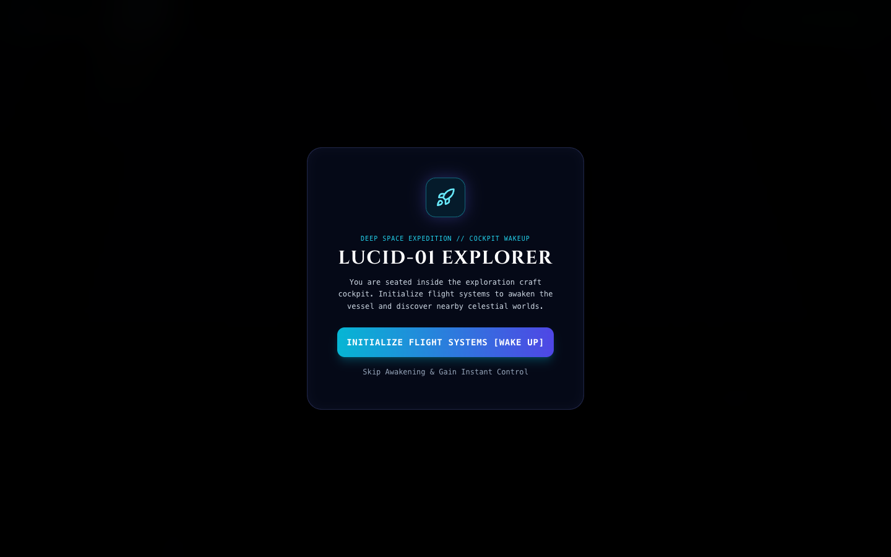
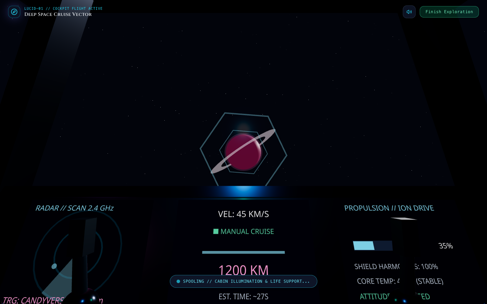
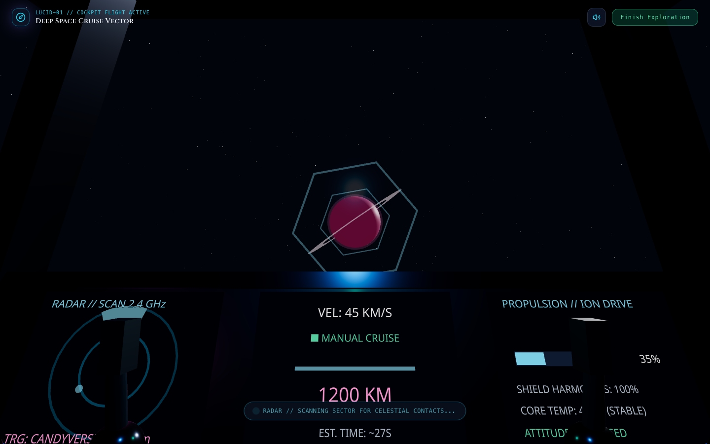
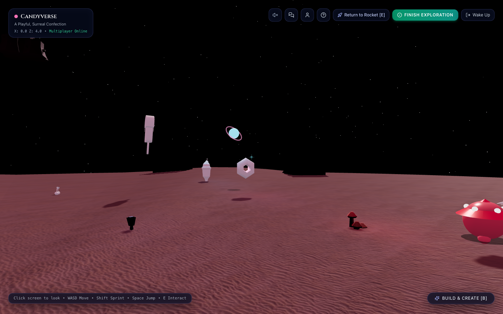
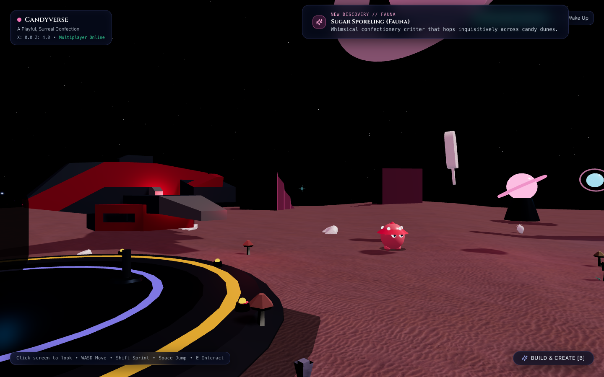
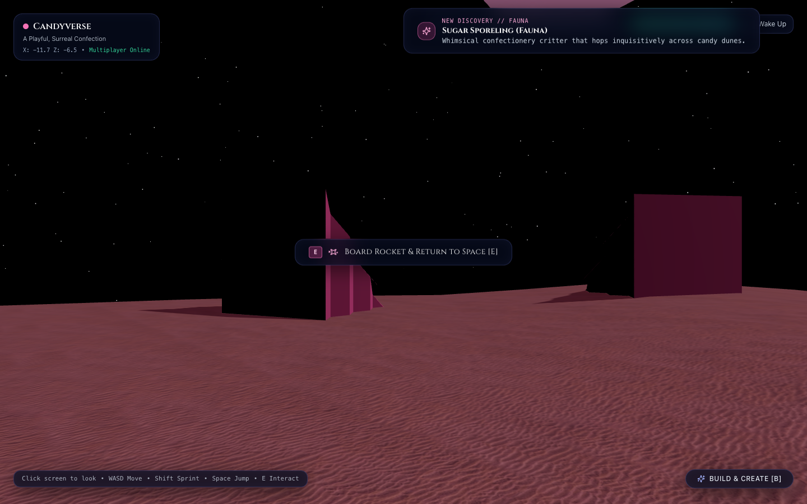
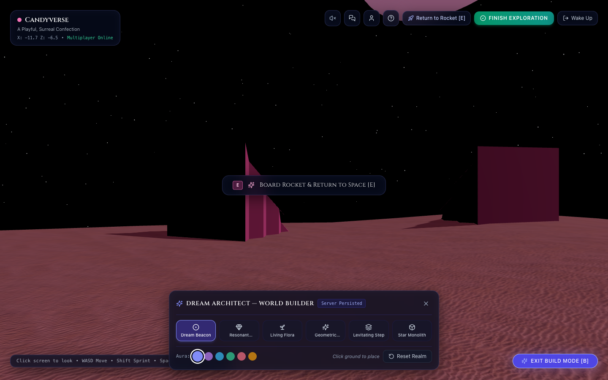
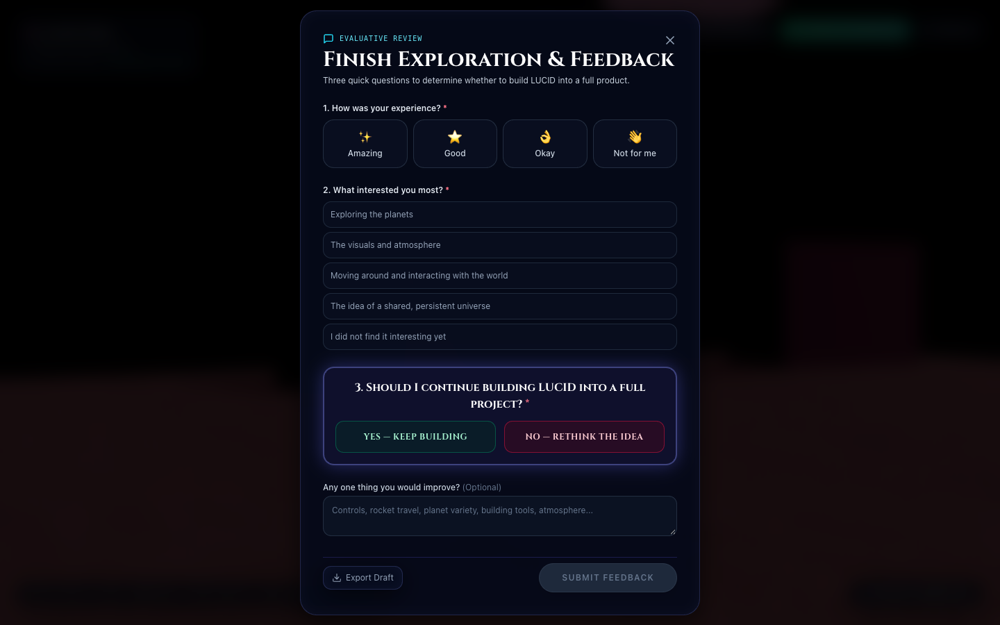
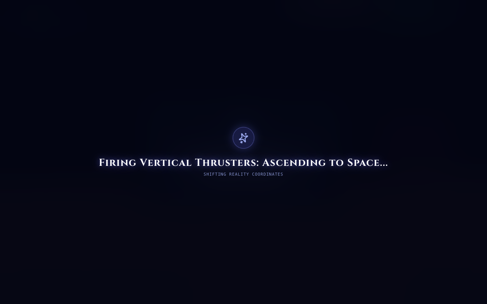
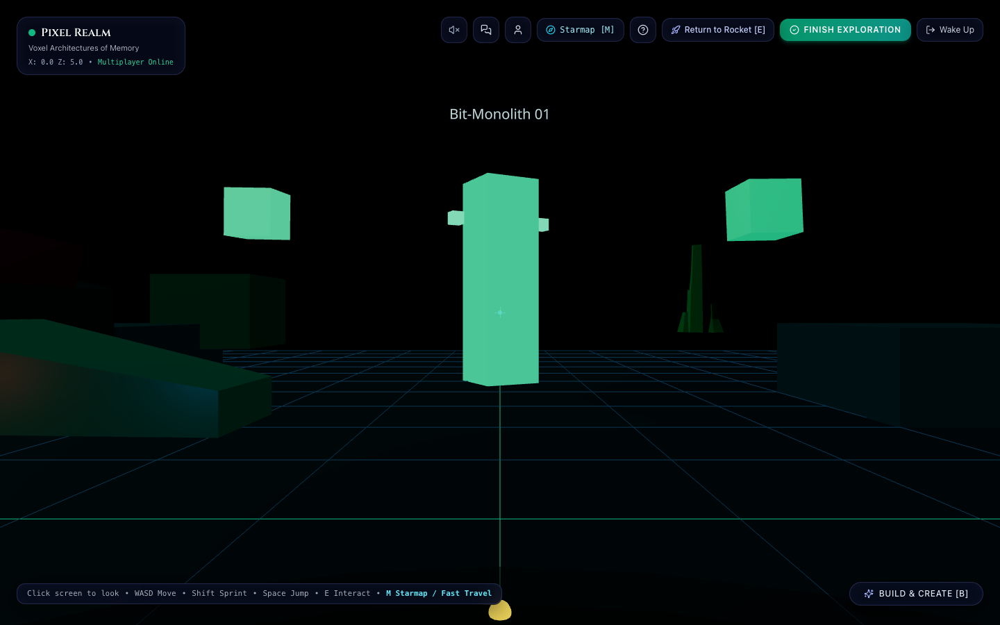

# LUCID: THE LIVING DREAM
### Interactive MVP Prototype — First-Person Spaceflight & Living Dream Multiverse

> *“A universe shaped by the people who wander through it. Some worlds are discovered. Others are created.”*

---

## 1. What is LUCID?

**LUCID** is a persistent, multiplayer, dreamlike virtual multiverse. Instead of opening an ordinary website or static 3D demonstration, visitors awaken seated inside the cockpit of an exploration spacecraft. Looking out through the canopy windshield into deep space, players pilot their vessel, detect nearby worlds using animated multi-function radar, navigate continuous atmospheric re-entry and landing sequences, step out on foot in true first person, discover living alien creatures and reactive flora, permanently build world structures, meet other wanderers in real-time, and return to their spacecraft to launch into the stars.

Each world in LUCID features a distinct aesthetic grammar, celestial orbit, surface gravity, acoustic drone chords, and interactive monuments.

---

## 2. Core Experience: The Continuous First-Person Journey

The prototype implements a continuous, uninterrupted exploration loop:

```
Deep Space Universe View ──► Select Destination ──► Spacecraft Telemetry Panel
                                                            │
                                                            ▼
Touchdown on Landing Pad ◄── Atmospheric Descent ◄── Interplanetary Warp Cruise
           │
           ▼
On-Foot Exploration ──► World Building ──► Return to Rocket [E] ──► Ascend to Space
```

1. **Phase A — Wake Up Inside the Spacecraft Cockpit**:
   - The application opens seated inside the vessel looking through the forward windshield.
   - Restrained cockpit interior with structural canopy arches, dual articulated flight sticks responding to steering inputs, and pilot suit forearms.
   - Progressive awakening sequence spooling life support, reactor glow, and cabin illumination.
2. **Phase B — Spacecraft Flight & Universal Planet Navigation**:
   - Responsive flight model: Throttle (`W`/`S`), Yaw steering (`A`/`D`), Roll (`Q`/`E`), Boost (`Shift`), and Autopilot lock (`Space`).
   - **Target Planet Cycling (`Tab` / `T`)**: Cycle through all 10 charted planetary realms in real time.
   - **Direct Planet Selection (`1` to `0`)**: Instantly lock any world ([1] Origin, [2] Candyverse, [3] Pixel Realm, [4] Nature Prime, [5] Glassia, [6] The Abyss, [7] Zephyr, [8] Ignis, [9] Astraea, [0] Chronos).
   - **Starmap Atlas (`M`)**: Open the 10-planet navigation atlas modal with archetype details, surface gravity, and instant target lock or warp buttons.
   - **3D Universe View (`U`)**: Seamlessly toggle into the 3D orbital multiverse map.
   - Dynamic 3D celestial globe outside the windshield transforms its colors, atmosphere, and rings to match the selected destination!
   - Multi-Function Radar Display: Sweeping 2.4 GHz radar tracks multiple celestial contacts in range and locks targeting reticle onto your chosen planet.
3. **Phase C — Continuous Flight Stages**:
   - *Cruise*: Navigating through holographic warp guidance gates across deep space.
   - *Approach*: The 3D celestial globe of Candyverse scales up naturally beyond the windshield.
   - *Atmospheric Entry*: Ionization glow, aerodynamic camera shake, and procedural atmospheric rumble.
   - *Descent & Touchdown*: Landing gear deployment, retro-thruster flare, and tactile touchdown.
4. **Phase D — First-Person Ground Exploration**:
   - True first-person perspective at natural eye-level (~1.68m).
   - Pointer-locked mouse look (`Click to lock`, `ESC to release`) with clamped pitch to prevent disorienting flips.
   - Subtle vertical head bobbing and roll tilt while walking and sprinting.
   - Dynamic landing compression dip and smooth damping recovery upon jumping and touching down.
   - Ground height queries `getTerrainElevation(x, z)` across dunes and contoured calderas.
5. **Phase E — Living Candyverse Flora & Fauna**:
   - **Sugar Sporelings**: Autonomous bouncy sugar critters with hopping physics, curious chirping, player proximity investigation, and `[E]` observation interactions.
   - **Sugar Wisps**: Floating bioluminescent dream wisps with sinusoidal hovering, resonant rings, and attunement interactions.
   - **Reactive Flora**: Singing Sporecaps, Harmonic Blossoms, and Frosting Blooms that intensify glow and harmonize as the player approaches.
   - **Discovery Journal**: Discovering new species triggers real-time discovery toasts and logs records into the field journal.
6. **Phase F — Return to Spacecraft & Flight Loop**:
   - The exploration lander craft remains parked on the landing pad at `[-6.5, 4]`.
   - Approaching displays `Board Rocket & Return to Space [E]`.
   - Pressing `E` boards the spacecraft, fires vertical ascent thrusters, and returns seamlessly to the first-person flight cockpit.
7. **Phase G — Central Procedural Audio Engine**:
   - Pure Web Audio synthesizer with zero external sound file dependencies:
   - Dynamic cockpit engine hum and ion boost acceleration.
   - Atmospheric re-entry wind rumble and turbulent pink-noise filtering.
   - Radar blip sweeps, target locking chime, landing gear hydraulics, and touchdown thud.
   - Powdered-sand footstep crunch synchronized to player movement cadence.
   - Natural jump impulse and landing impact.
   - Whimsical creature chirps and resonant harmonic plant chords.

---

## 3. Visual Tour & Screenshots

All high-fidelity screenshots are captured directly from the running prototype in the [`screenshots/`](./screenshots/) directory:

| Cockpit Awakening | Flight Telemetry & Radar Target Lock | Atmospheric Entry Corridor |
| :---: | :---: | :---: |
|  |  |  |

| Candyverse Surface Exploration | Living Fauna & Discovery Toast | The Great Sugar Spire |
| :---: | :---: | :---: |
|  |  |  |

| First-Person World Builder | 3-Question Evaluation Feedback Survey | Ascent & Return to Space |
| :---: | :---: | :---: |
|  |  |  |

| Multiverse Starmap Atlas (`M`) | Cockpit Targeting Pixel Realm | Pixel Realm Exploration |
| :---: | :---: | :---: |
|  |  |  |

---

## 4. Realism & Environment Quality Architecture

The prototype features a complete realism upgrade, replacing primitive placeholders with game-ready CC0 3D models, procedural contoured terrain, skeletal humanoid animations, and atmospheric studio lighting:

### A. Sourced CC0 / Open Source Game-Ready Asset Pipeline
All assets are high-performance, low-draw-call, game-ready 3D models and PBR textures licensed under CC0 / Public Domain / MIT (zero paid dependencies):
- **Rigged Humanoid Explorer** ([`explorer.glb`](./apps/web/public/assets/models/explorer.glb)):
  - Fully articulated humanoid explorer with complete bone skeleton (`mixamorig` hierarchy).
  - Skeletal animation controller with smooth cross-fading: `idle` breathing, `walk` stride, and `run` sprint.
  - PBR customizable suit materials (`avatarConfig.color`) with metallic joints, normal-mapped surface details, and feet contact shadows.
- **Exploration Lander Spacecraft** ([`craft_speederD.glb`](./apps/web/public/assets/models/spacecraft/craft_speederD.glb)):
  - Coherent aerospace silhouette with cockpit canopy blister (tinted glass with interior holographic HUD glow).
  - Heavy flanking engine nacelles with cooling ribs and exhaust cowlings.
  - Multi-stage hydraulic landing gear: articulated nose strut, angled port/starboard main gear, and heavy hexagonal footpads grounded on $y = 0.0$.
  - Subtle dual ion thruster plasma effects with oscillating shock diamond cores and 1.2 Hz aviation strobe lights.
- **Candyverse Confectionery Asset Library** (Kenney CC0):
  - Landmark Foundation: Birthday Cake Pedestal ([`cake-birthday.glb`](./apps/web/public/assets/models/candy/cake-birthday.glb)) and Layered Cake ([`cake.glb`](./apps/web/public/assets/models/candy/cake.glb)).
  - Glazed Donut Megaliths ([`donut.glb`](./apps/web/public/assets/models/candy/donut.glb), [`donut-sprinkles.glb`](./apps/web/public/assets/models/candy/donut-sprinkles.glb), [`donut-chocolate.glb`](./apps/web/public/assets/models/candy/donut-chocolate.glb)).
  - Basalt Waffle Monoliths ([`waffle.glb`](./apps/web/public/assets/models/candy/waffle.glb)).
  - Swirl Popsicle & Soft-Serve Trees ([`popsicle.glb`](./apps/web/public/assets/models/candy/popsicle.glb), [`popsicle-chocolate.glb`](./apps/web/public/assets/models/candy/popsicle-chocolate.glb), [`ice-cream-cne.glb`](./apps/web/public/assets/models/candy/ice-cream-cne.glb), [`sundae.glb`](./apps/web/public/assets/models/candy/sundae.glb)).
  - Cookie Boulders & Chocolate Slabs ([`cookie.glb`](./apps/web/public/assets/models/candy/cookie.glb), [`cookie-chocolate.glb`](./apps/web/public/assets/models/candy/cookie-chocolate.glb), [`chocolate.glb`](./apps/web/public/assets/models/candy/chocolate.glb)).
  - Bioluminescent Confectionery Mushrooms ([`mushroom_redTall.glb`](./apps/web/public/assets/models/nature/mushroom_redTall.glb), [`mushroom_redGroup.glb`](./apps/web/public/assets/models/nature/mushroom_redGroup.glb)).
- **Planetary Surface & Celestial Textures** (Poly Haven & NASA CC0):
  - Powdered sugar & dune ripples (`sand_diff_1k.jpg`, `sand_nor_1k.jpg`).
  - Rocky ground bump maps (`rocky_terrain_diff_1k.jpg`, `rocky_terrain_nor_1k.jpg`).
  - High-resolution planetary surfaces and dynamic clouds (`earth_atmos_2048.jpg`, `earth_clouds_1024.png`, `moon_1024.jpg`).

### B. Primary Polished Environment: Candyverse
Candyverse serves as the primary showcase environment:
1. **The Great Sugar Spire**: Monumental centerpiece at `[0, 0, -13]` featuring a birthday cake base, strawberry sugar obelisk, rotating glazed sprinkle donut ring, levitating crystal crown, and radiant beacon light.
2. **Organic Powdered Sugar Dunes**: Procedural undulating surface matching `getTerrainElevation(x, z)` with a flat landing pad apron.
3. **Surreal Landscape Composition**: Half-buried chocolate donuts, towering waffle shelves, swirl popsicles, and bioluminescent mushrooms casting soft point lighting.
4. **Perimeter Mountain Caldera**: 10 cliff formations enclosing the valley to prevent abrupt horizon clipping.
5. **Atmospheric Lighting**: Cosmic dusk sky (`#240931`), confection fog (`#3d1547`), warm golden sun (`#fff7ed`), and distant celestial ringed moon.

### C. Grounded Physics & Dynamic Height Tracking
- **Dynamic Terrain Elevation**: Character controller queries `getTerrainElevation(x, z)` during physics updates, keeping the explorer's boots grounded to the contours of the dunes and hills without sinking or floating.
- **Sliding Obstacle Collisions**: Cylinder-cylinder collision prevents walking through the lander, monuments, spires, and user-built structures.
- **Safe Recovery**: Fall-off bounds soft-recovery safely returns out-of-bounds players to spawn.

---

## 5. Planetary Multiverse Catalog

LUCID includes 10 charted planetary realms across diverse archetypes:

| Planet | Archetype | Atmosphere & Gravity | Landmark / Key Monument |
| :--- | :--- | :--- | :--- |
| **Origin** | Cosmic Nexus Hub | Deep indigo, $g = 9.8\text{ m/s}^2$ | *The Monolith of Origin* |
| **Candyverse** | Confectionery Dream | Pastel marshmallow, $g = 4.8\text{ m/s}^2$ | *The Great Sugar Spire* |
| **Pixel Realm** | Digital Voxel World | Retro digital grid, $g = 10.5\text{ m/s}^2$ | *The Infinite Bit Altar* |
| **Nature Prime** | Living Bio-Canopy | Spore auroras, $g = 8.5\text{ m/s}^2$ | *The Mother Spore Grove* |
| **Glassia** | Prismatic Shard World | Crystalline cyan, $g = 9.0\text{ m/s}^2$ | *The Prism Citadel* |
| **The Abyss** | Oceanic Ruin | Deep bioluminescent, $g = 2.2\text{ m/s}^2$ | *The Sunken Trench Shrine* |
| **Zephyr** | Gas Giant / Sky Citadels | Floating amber cloud, $g = 6.2\text{ m/s}^2$ | *Cloudspire Observatories* |
| **Ignis** | Volcanic Ember Realm | Obsidian shards & magma, $g = 12.0\text{ m/s}^2$ | *The Core Caldera* |
| **Astraea** | Crystalline Ice Shards | Polar auroras & glacial towers, $g = 7.5\text{ m/s}^2$ | *The Frost Needle Sanctuary* |
| **Chronos** | Clockwork Astral Realm | Orbiting brass rings & gears, $g = 8.0\text{ m/s}^2$ | *The Grand Horologium* |

---

## 6. Persistent World Building

Visitors can permanently alter the reality of any planet using the **Dream Architect World Builder** (`B` key):
- **Dream Beacon**: Pulsing radiant guidance orb with animated corona.
- **Resonant Crystal**: Prismatic quartz emitting harmonic synth resonance.
- **Living Flora**: Bioluminescent dream mushrooms that glow in the dark.
- **Geometric Relic**: Nested kinetic wireframe structures.
- **Levitating Step**: Floating platform for custom parkour paths.
- **Star Monolith**: Ancient dark runic pillar.

**Honest Dual Persistence**:
- **Local Demo Mode**: Automatically active when backend is offline. World modifications are stored in browser `localStorage` and persist through tab closures and world hops.
- **Connected Multiplayer**: With the backend active, placed objects are validated, stored authoritatively, and instantly broadcast to all connected wanderers via Socket.IO.

---

## 7. Streamlined Product Evaluation & Feedback

To evaluate whether LUCID is worth developing into a full-scale commercial product, the application features an integrated **Finish Exploration** flow:
- Accessible at any time via the prominent **Finish Exploration** button in the HUD and on the landing pad.
- **Three Required Evaluative Questions**:
  1. *How was your experience?* (`Amazing`, `Good`, `Okay`, `Not for me`)
  2. *What interested you most?* (`Exploring the planets`, `The visuals and atmosphere`, `Moving around and interacting with the world`, `The idea of a shared, persistent universe`, `I did not find it interesting yet`)
  3. *Should I continue building LUCID into a full project?* (Two balanced, unbiased choices: **`YES — KEEP BUILDING`** vs **`NO — RETHINK THE IDEA`**)
- **One Optional Field**: *Any one thing you would improve?*
- The submit button remains disabled until all 3 required questions are answered.
- Submissions save to the API server when connected, with a fallback local draft and 1-click JSON export.

---

## 8. Technology Stack

- **Frontend**:
  - React 18 & TypeScript
  - Vite 5 (Bundler & Preview Server)
  - Three.js (`three` r169)
  - React Three Fiber (`@react-three/fiber` v8)
  - Drei (`@react-three/drei` v9)
  - Zustand 4 (Reactive universe state machine)
  - Tailwind CSS 3 (Styling & sci-fi telemetry glass panels)
  - Lucide React (Icons)
  - Custom Web Audio API Synthesizer (Chords & Chimes)
- **Backend**:
  - Node.js (v20+ / v24)
  - Express 4 (REST API)
  - Socket.IO 4 (Real-time gateway & planetary rooms)
  - TypeScript & TSX
- **Quality Assurance**:
  - Vitest (Unit & real-time multiplayer socket integration tests)
  - Headless Chrome (`puppeteer-core`) for screenshot verification

---

## 9. How to Run Locally

### Quick Start
```bash
# 1. Install dependencies
pnpm install

# 2. Build shared contracts
pnpm --filter @lucid/shared build

# 3. Start development servers
pnpm dev
```

- **Frontend Client**: http://localhost:5173 (or http://localhost:5174)
- **Backend API Server**: http://localhost:4000
- **API Health Check**: http://localhost:4000/api/health

### Production Build & Preview
```bash
# Build all workspaces
pnpm build

# Start preview server
pnpm --filter lucid-web preview --port 5174
```

### Running Automated Checks
```bash
# Run unit & multiplayer tests
pnpm test

# Run TypeScript typechecks
pnpm typecheck
```

---

## 10. Complete Controls & Navigation Guide

### A. Spacecraft Cockpit Flight & Planet Targeting
- **`W` / `S`**: Throttle propulsion up / down
- **`A` / `D`**: Yaw steering (steer left / right)
- **`Q` / `E`**: Roll orientation axis
- **`Shift` (Hold)**: Engage high-output Ion Drive Boost
- **`Space`**: Toggle Autopilot Vector Stabilization
- **`Tab` / `T`**: Cycle Celestial Target forward through all 10 planets
- **`Shift + Tab` / `R`**: Cycle Celestial Target backward
- **`1` to `0`**: Direct Target Planet Selection:
  - `1`: Origin
  - `2`: Candyverse
  - `3`: Pixel Realm
  - `4`: Nature Prime
  - `5`: Glassia
  - `6`: The Abyss
  - `7`: Zephyr (Cloud City)
  - `8`: Ignis (Molten Core)
  - `9`: Astraea (Glacial Moon)
  - `0`: Chronos (Clockwork Matrix)
- **`M`**: Open Multiverse Starmap Navigation Atlas
- **`U`**: Switch to 3D Orbital Universe View
- **Mouse Drag**: Free cockpit view look around

### B. First-Person Ground Exploration
- **`W`, `A`, `S`, `D` / Arrow Keys**: Walk across dunes and planetary terrain
- **Click Screen**: Engage Pointer Lock mouse look (`ESC` to release)
- **`Shift` (Hold)**: Sprint with dynamic head bobbing
- **`Space`**: Jump (scaled by planetary surface gravity)
- **`E`**: Contextual interaction:
  - Board Spacecraft & return to deep space (when near lander at `[-6.5, 4]`)
  - Observe & log living fauna / flora into field discovery journal
  - Commune / Awaken planetary central landmarks
- **`B`**: Toggle Dream Architect World Builder palette
- **`M`**: Open Starmap Atlas for instant planetary fast travel or retargeting
- **Mobile Touch**: Virtual joystick for movement + Jump & Action buttons

---

## 11. Repository Structure

```
LUCID/
├── apps/
│   ├── api/                              # Backend Express & Socket.IO server
│   │   ├── src/
│   │   │   ├── modules/
│   │   │   │   ├── feedback/             # 3-question survey & export controllers
│   │   │   │   ├── multiplayer/          # Real-time room synchronization
│   │   │   │   └── world/                # World state & object persistence
│   │   │   ├── storage/worldStore.ts     # Authoritative storage layer
│   │   │   └── server.ts                 # Listener on port 4000
│   └── web/                              # Frontend React + Three.js client
│       ├── src/
│       │   ├── app/App.tsx               # Main view dispatcher & overlays
│       │   ├── features/
│       │   │   ├── controls/             # Grounded physics & cylinder obstacle collisions
│       │   │   ├── feedback/             # Evaluative 3-question survey modal
│       │   │   ├── landing/              # Hero view & cosmic gateway
│       │   │   ├── spacecraft/           # Procedural 3D rocket, landing pad, flight overlay
│       │   │   ├── universe/             # Dedicated 3D deep space exploration scene
│       │   │   ├── planets/              # 10 planetary surface environments
│       │   │   └── world-builder/        # Holographic placement & palette
│       │   └── stores/useUniverseStore.ts# TravelState machine & state store
├── packages/
│   └── shared/                           # Shared types, travel states, planet catalog
├── docs/                                 # Source of Truth PDF
├── screenshots/                          # Verified high-res screenshots
└── capture-screenshots.mjs               # Puppeteer screenshot capture automation
```

---

*LUCID: The Living Dream — MVP Prototype. All features verified with automated tests and visual captures.*
