# LUCID: THE LIVING DREAM
### Prototype Release — Persistent Virtual Universe, First-Person Spaceflight & Planetary Exploration

> *“A universe shaped by the people who wander through it. Some worlds are discovered. Others are created.”*

---

## 1. Project Overview

**LUCID: The Living Dream** is a browser-playable prototype exploring the foundations of a persistent, interconnected virtual universe.

Instead of opening a standard webpage or a detached map menu, visitors awaken directly inside the cockpit of an exploration spacecraft looking out into deep space. The prototype combines first-person manual spaceflight, dynamic orbital navigation instruments, atmospheric descent, manual planetary landing, on-foot surface exploration under celestial suns, persistent world building, real-time multiplayer presence, and direct community feedback collection into a continuous browser experience.

The objective of this prototype release is to test and demonstrate the core gameplay loop, technical feasibility, and experiential feel of physical navigation between distinct worlds before expanding the universe further.

---

## 2. Vision

The long-term ambition for LUCID is to create an open, living multiverse characterized by:

- **Distinct Interconnected Worlds**: A vast cosmos of planets, each possessing unique physical laws, visual identities, procedural ecologies, and architectural legacies.
- **Immersive Exploration**: Seamless transitions between spaceflight, orbital approach, atmospheric entry, and first-person surface traversal without immersion-breaking loading walls.
- **Meaningful Discovery**: Rewarding wanderers who chart unexplored sectors with emergent lore, ancient monuments, ecological observations, and hidden relics.
- **Shared Experiences**: A persistent multiplayer substrate where players encounter one another, share discoveries, communicate across sectors, and embark on expeditions together.
- **An Evolving Universe**: Player-driven construction, terraforming, and settlement where wanderers leave permanent marks on the worlds they inhabit.

> **Vision vs. Current Prototype Scope**:  
> The long-term vision encompasses an expansive galaxy with procedural generation, economies, player governance, and deep survival mechanics. The current prototype is a focused proof-of-concept designed to demonstrate that the fundamental physical flight feel, cockpit guidance systems, planetary discovery loop, and hybrid persistence can run smoothly in any modern web browser.

---

## 3. Current Prototype

The prototype currently implements the following functional systems:

- **First-Person Spacecraft Flight**:
  - Full 360° continuous yaw and pitch steering with mouse and keyboard.
  - Articulated flight sticks, canopy arches, and pilot cockpit interior.
  - Progressive awakening sequence initializing cabin systems.
  - Manual throttle control, reverse retro-braking, and ion drive superluminal boost.
- **Velocity-Responsive Spaceflight Visuals**:
  - Dynamic velocity streaks and spatial dust particles that derive directly from the spacecraft's true physical velocity vector.
  - Inertia-preserving coasting: releasing thrusters leaves motion streaks visible while the vessel drifts through space until friction or retro-thrusters arrest momentum.
- **Ten Planetary Destinations**:
  - A charted cosmos of 10 distinct worlds: **Origin**, **Candyverse**, **Pixel Realm**, **Nature Prime**, **Glassia**, **The Abyss**, **Zephyr**, **Ignis**, **Astraea**, and **Chronos**.
  - Visible celestial suns and stars casting natural directional shadows and atmospheric bounce.
  - Procedural sky domes, horizon skirts, and terrain contours.
- **Planet-Specific Narrative Content**:
  - Lore descriptions, thematic identities, project vision reflections, and suggested exploration activities for all 10 planets.
  - Contextual floating discovery cards anchored off-center from planetary bodies that appear during approach and can be dismissed without obscuring the pilot's forward reticle.
- **Interactive 10-Step Flight Tutorial**:
  - In-cockpit guided training sequence covering mouse-look orientation, throttle acceleration, coasting, deceleration, manual steering, targeting, scanner pulses, approach alignment, landing gear deployment, and atmospheric touchdown.
  - Dual progression: automatic detection of player actions plus manual progression buttons on every step so players never get stuck.
- **Three Flight Assistance Levels & Autonomous Navigation**:
  - **Mode A (Manual Flight)**: Complete pilot authority with raw physical thrust, manual 360° steering, roll trim, and momentum coasting.
  - **Mode B (Assisted Flight)**: Soft orientation alignment, lateral drift damping, approach speed corridors, and landing level assistance.
  - **Mode C (Autopilot)**: Full physical autonomous navigation toward any selected world with bounded acceleration, automatic cruising speed (~88 km/s), smooth corridor deceleration, and surface hold. Instant manual override upon any pilot control input (`W/S/A/D/mouse/Space`).
- **Tactical Planet Radar & Non-Overlapping Cockpit Layout**:
  - Dedicated 2D tactical circular radar scope with range scaling (`600K`, `1800K`, `3000K`), sweep scanner, relative bearing, target locks, and distance readouts.
  - Non-overlapping lower instrument deck: radar and gyrometer/attitude indicator are structured in dedicated sibling containers, guaranteeing unobstructed visibility across all viewports.
- **Guided Exploration Tour Mode**:
  - Hands-free sector-to-sector tour with intelligent next-destination recommendations, pause-on-foot state preservation, and user-confirmed progression.
- **Navigation Recovery System**:
  - Automated detection when drifting far into deep void or traveling away from destinations, offering 1-click nearest planet locking and autopilot recovery.
- **Navigation Atlas (`M`)**:
  - Starmap modal displaying all 10 worlds with coordinates, atmospheric data, gravity, and narrative lore.
- **Planetary Approach, Landing & On-Foot Exploration**:
  - Atmospheric ionization entry effects, camera turbulence, and GPWS altitude warnings.
  - Touchdown on surface landing pads followed by disembarking (`E`) into first-person exploration mode.
  - Pointer-locked mouse look, terrain height conformity, footsteps, jumping, and sprint dynamics.
  - Reactive flora, living fauna (Sugar Sporelings & Sugar Wisps on Candyverse), and interactive monoliths.
  - Boarding the lander craft (`E`) fires vertical liftoff thrusters and returns to deep space.
- **Flight Sensitivity Settings**:
  - Three distinct presets (`Smooth / Low`, `Standard / Balanced`, `Agile / High`) accessible via the Controls menu (`H`) to tune mouse-look sensitivity and steering response to player preference.
- **Existing Multiplayer Substrate**:
  - Socket.IO gateway supporting planetary room isolation, peer avatar position synchronization, chat messaging, and collaborative object building.
  - *Configuration Requirement*: Requires a running Node.js backend (`apps/api`). If the backend is unreachable or offline, the client automatically defaults to local demo mode.
- **Feedback Submission & Persistent Storage**:
  - 3-question structured evaluation survey (`Experience`, `Primary Interest`, `Should LUCID Continue?`) plus an optional improvements field.
  - Persistent MongoDB Atlas cloud storage via REST API, supplemented by resilient offline local draft queuing and 1-click JSON export.

---

## 4. Visual Tour & Verified Screenshots

High-fidelity screenshots captured directly from the running prototype in the [`screenshots/`](./screenshots/) directory:

### Flight Guidance HUD & Spacecraft Navigation
| Flight Guidance HUD Overview | Target Vector Aligned (`≤ 4°`) | Velocity Vector & Drift Telemetry |
| :---: | :---: | :---: |
| 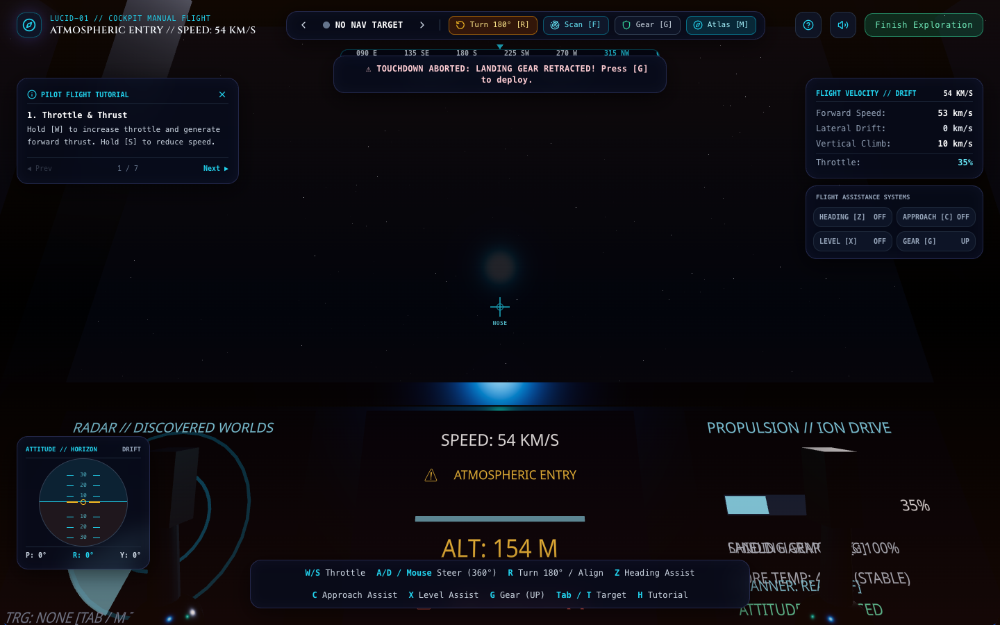 | 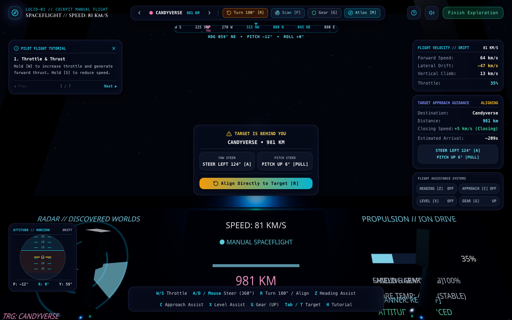 | 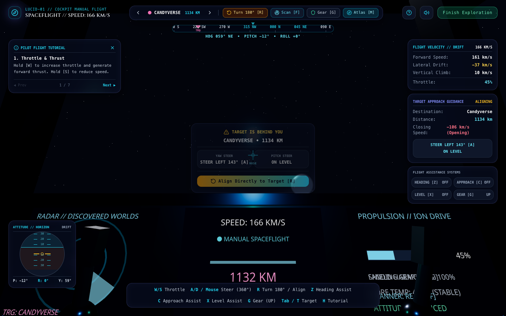 |

| Off-Screen Guidance & Steering Corrections | Cockpit Landed Atmospheric Lighting | Cockpit Targeting Pixel Realm |
| :---: | :---: | :---: |
| 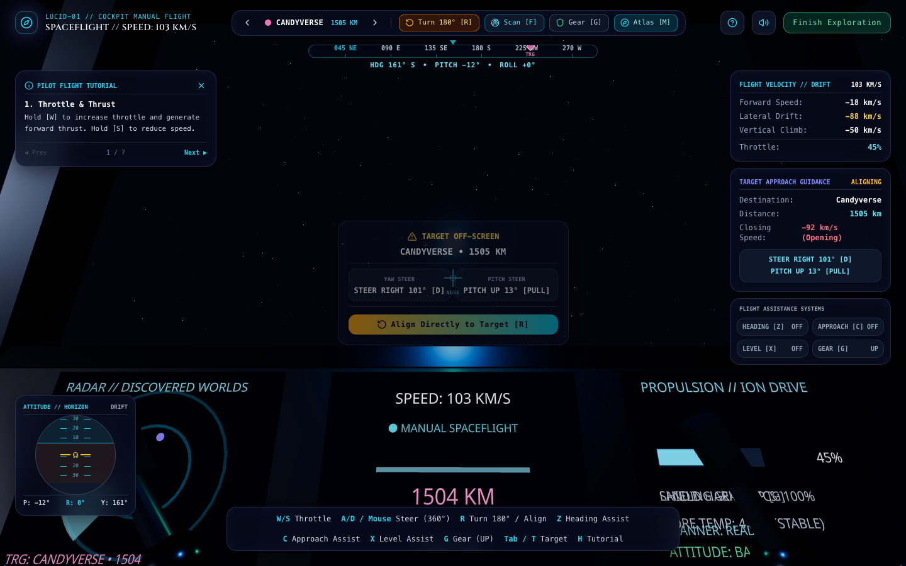 | 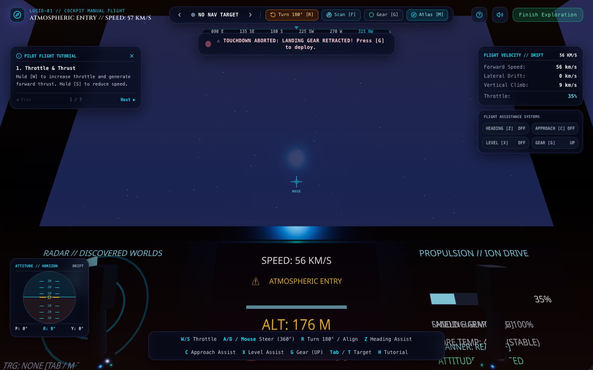 | 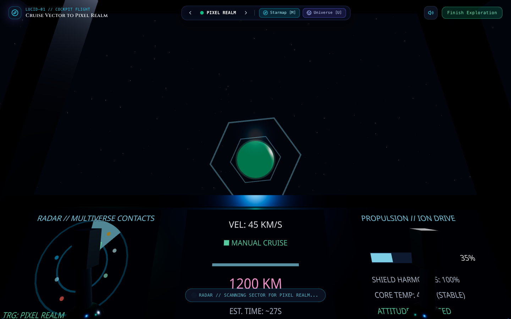 |

### Planetary Exploration, Visible Sun & Atmosphere
| Candyverse Visible Golden Sun & Sky Dome | Candyverse Spire & Horizon Skirt | Origin Visible Star & Monolith |
| :---: | :---: | :---: |
| 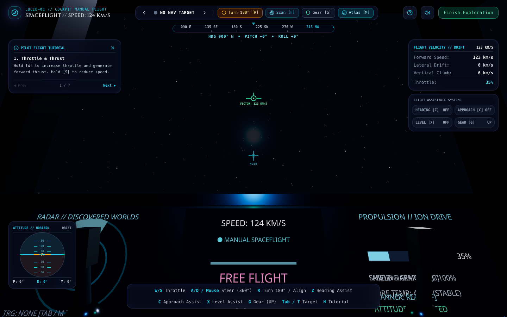 | 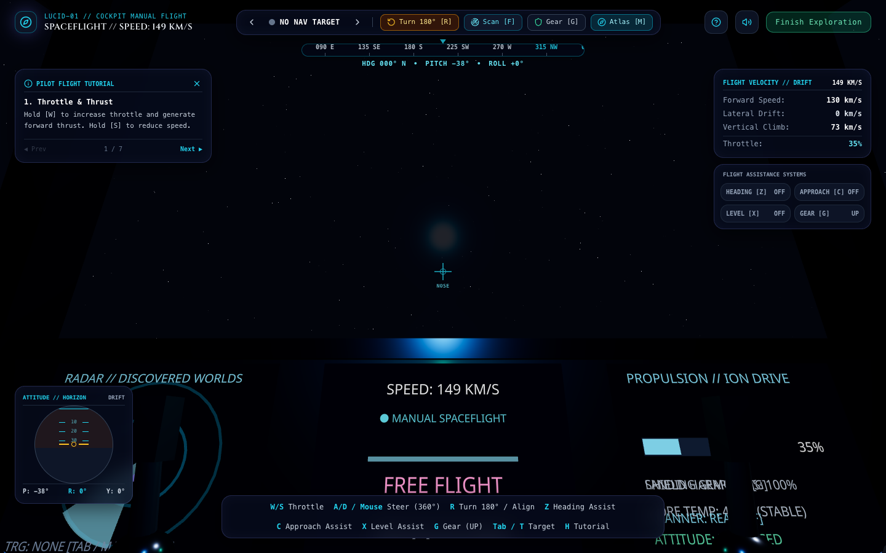 | 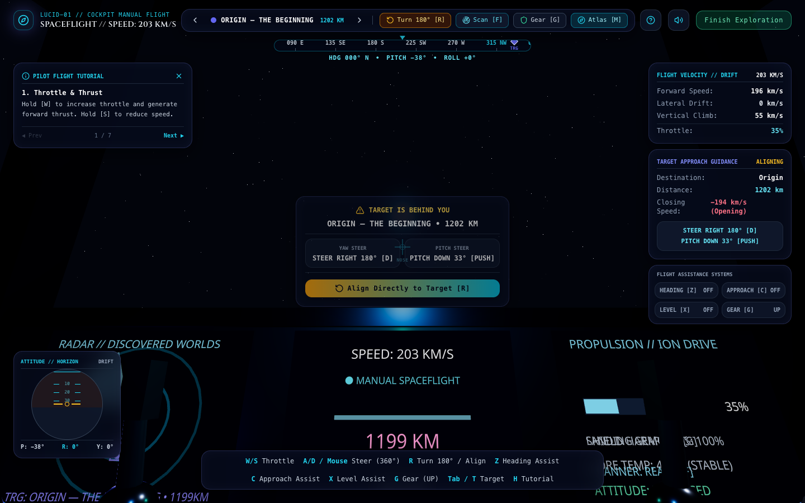 |

| Nature Prime Canopy Sun & Foliage | Production Feedback Evaluation Modal | Multiverse Starmap Atlas (`M`) |
| :---: | :---: | :---: |
| 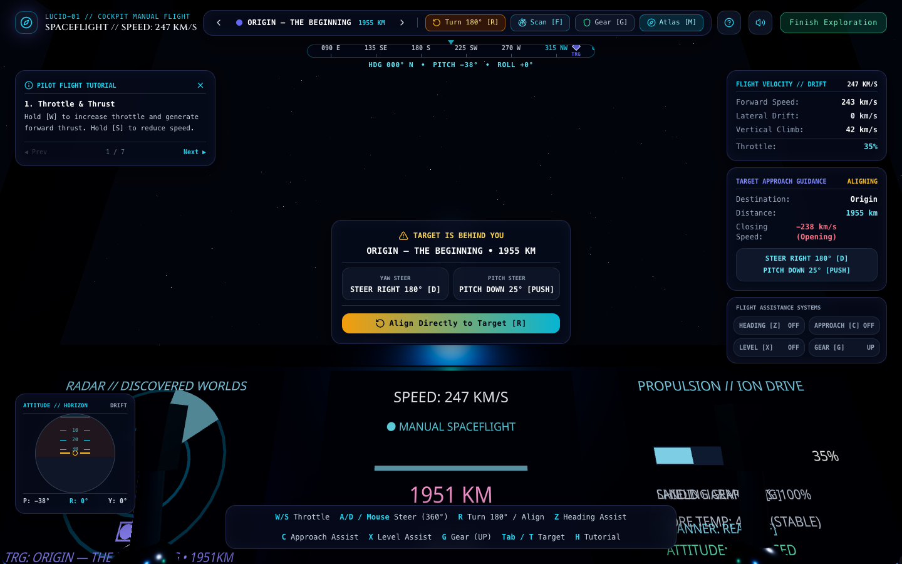 | 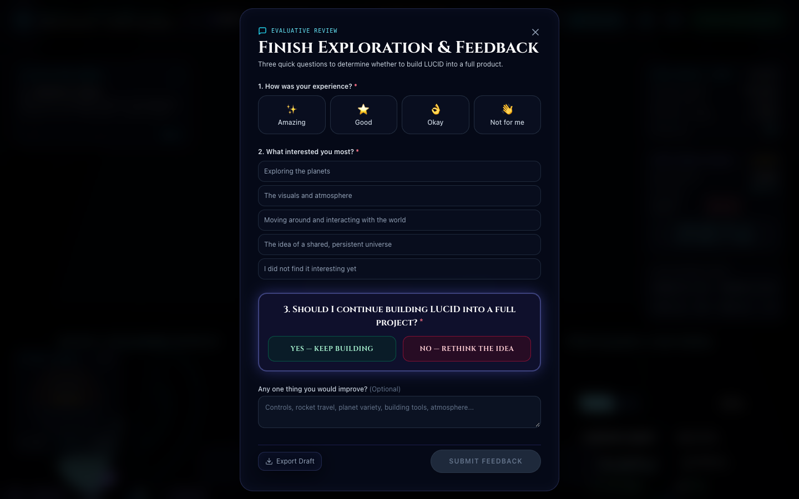 | 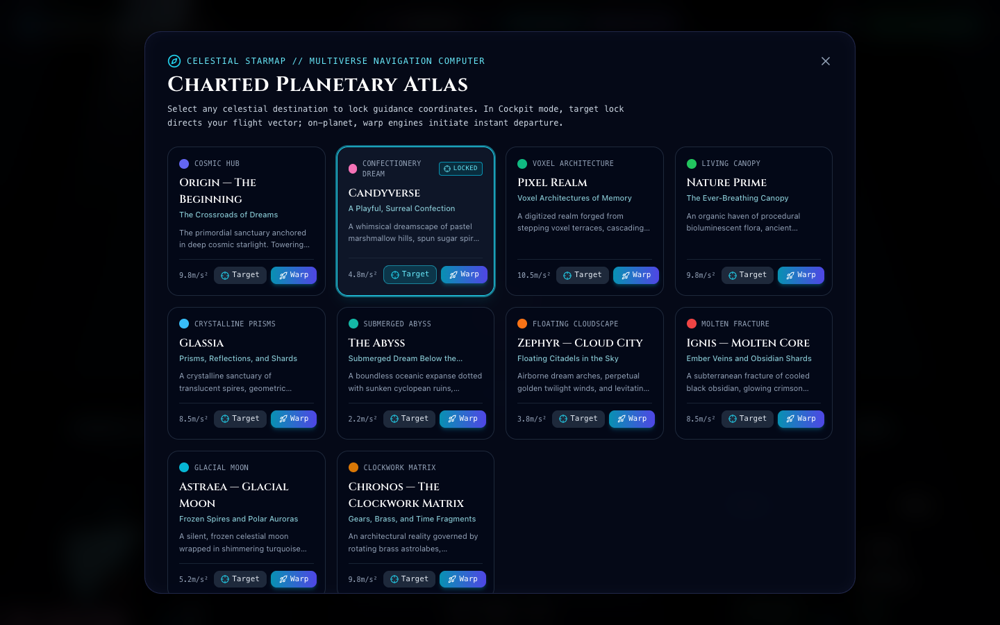 |

---

## 5. Technology Stack

- **Frontend (`apps/web`)**:
  - **Framework**: React 18 & TypeScript 5.5
  - **Bundler & Dev Server**: Vite 5
  - **3D Graphics**: Three.js (r169), React Three Fiber (`@react-three/fiber` v8), Drei (`@react-three/drei` v9)
  - **State Management**: Zustand 4 (reactive universe & flight state machine)
  - **Styling**: Tailwind CSS 3 (futuristic telemetry panels and HUD overlays)
  - **Icons**: Lucide React
  - **Audio**: Custom procedural Web Audio API synthesizer (engine drones, thrusters, radar chimes, atmosphere)
- **Backend (`apps/api`)**:
  - **Runtime**: Node.js (>= 20.0.0)
  - **API Framework**: Express 4 (REST endpoints for health, worlds, feedback)
  - **Realtime Networking**: Socket.IO 4 (peer presence, room multiplexing, object synchronization)
  - **Database Driver**: MongoDB Node Driver 7 (Atlas cloud persistence)
  - **TypeScript Execution**: `tsx` in development, `tsc` with `tsconfig.build.json` in production
- **Shared Contracts (`packages/shared`)**:
  - Centralized TypeScript package exporting types, schemas, planet catalog, travel states, and feedback definitions.
- **Tooling & Package Manager**:
  - **Package Manager**: `pnpm` 9 (v9.15.4) with monorepo workspace filtering
  - **Test Runner**: Vitest 2
  - **Static Type Checking**: TypeScript `tsc --noEmit`

---

## 6. Architecture

The codebase is organized as a lightweight pnpm monorepo:

```
LUCID/
├── .env.example                          # Canonical environment configuration template
├── vercel.json                           # Vercel deployment manifest & API reverse-proxy
├── render.yaml                           # Render Blueprint manifest for API & static services
├── packages/
│   └── shared/                           # @lucid/shared workspace package
│       ├── src/
│       │   ├── index.ts                  # Planet metadata, narrative, feedback schemas, types
│       │   └── index.test.ts             # Contract validation tests
│       └── package.json
├── apps/
│   ├── web/                              # Frontend React + Three.js client
│   │   ├── src/
│   │   │   ├── app/App.tsx               # Root dispatcher and modal overlays
│   │   │   ├── features/
│   │   │   │   ├── cockpit/              # Spacecraft cockpit, guidance HUD, velocity effects
│   │   │   │   ├── controls/             # Surface exploration FPS controls & collision
│   │   │   │   ├── feedback/             # 3-question feedback modal
│   │   │   │   ├── planets/              # Planetary scenes, atmospheres, skies, fauna/flora
│   │   │   │   ├── ui/                   # First-visit intro, controls manual, starmap atlas
│   │   │   │   ├── world-builder/        # Dream Architect building tools
│   │   │   │   └── multiplayer/          # Socket.IO client connection hook
│   │   │   ├── stores/useUniverseStore.ts# Core reactive game state machine
│   │   │   └── lib/                      # Persistence manager, Web Audio synthesizer
│   │   └── package.json
│   └── api/                              # Backend Express & Socket.IO server
│       ├── src/
│       │   ├── modules/
│       │   │   ├── feedback/             # Feedback controller & export endpoints
│       │   │   ├── multiplayer/          # Socket.IO real-time multiplayer handlers
│       │   │   └── world/                # World state controllers
│       │   ├── storage/                  # MongoDB Atlas connection & in-memory fallback
│       │   └── server.ts                 # HTTP & WebSocket server entrypoint
│       └── package.json
├── docs/                                 # Initial v1 specification PDF
├── screenshots/                          # Verified high-resolution screenshots
└── scripts/                              # Verification and screenshot capture scripts
```

---

## 7. Getting Started

### Prerequisites
- **Node.js**: `>= 20.0.0`
- **pnpm**: `>= 9.0.0` (`npm install -g pnpm@9.15.4`)

### Installation
Clone the repository and install workspace dependencies:
```bash
git clone https://github.com/Error-Krishna/Lucid---The-Living-Dream.git
cd Lucid---The-Living-Dream

pnpm install
```

### Build Shared Contracts
Build the shared TypeScript contracts before running application code:
```bash
pnpm --filter @lucid/shared build
```

### Local Development
To run both the web client and backend API concurrently:
```bash
pnpm dev
```
Or run individual workspace applications independently:
```bash
# Start frontend only (http://localhost:5173)
pnpm dev:web

# Start backend API only (http://localhost:4000)
pnpm dev:api
```

### Quality Assurance & Verification
```bash
# Run unit & integration tests across all packages
pnpm test

# Run TypeScript type checking across all packages
pnpm typecheck

# Build all packages for production
pnpm build
```

---

## 8. Controls Reference

Every control has been audited and verified directly against the game's input-handling code:

### Spacecraft Cockpit Flight & Planet Targeting
| Key / Input | Action |
| :--- | :--- |
| **W / S** | Throttle propulsion Up / Down (Hold `W` while landed to launch) |
| **S** (In Flight) | Engage active reverse retro-braking thrusters |
| **A / D** | Continuous Yaw steering (Left / Right) |
| **Mouse Drag / Move** | Free-look and 360° continuous Yaw & Pitch steering |
| **Q / E** | Roll banking trim (Left / Right) |
| **Shift** (Hold) | Engage high-output Ion Superluminal Boost |
| **R** | Quick Turnaround 180° / Align nose directly to selected target vector |
| **F** | Pulse Long-Range Holographic Scanner (discovers distant worlds) |
| **G** | Deploy / Retract tactile Landing Gear |
| **Z** | Toggle **Heading Assistance** (smooth orientation dampening toward target) |
| **C** | Toggle **Approach Assistance** (dampens lateral drift relative to approach corridor) |
| **X** | Toggle **Landing Level Assistance** (auto-levels pitch and roll during descent) |
| **Space** | Toggle Autopilot Vector Stabilization / Takeoff thrust |
| **Tab / T** | Cycle Target Navigation Reference (`Shift + Tab` for reverse cycle) |
| **1 – 0** | Direct Target Select: `1`: Origin, `2`: Candyverse, `3`: Pixel Realm, `4`: Nature Prime, `5`: Glassia, `6`: The Abyss, `7`: Zephyr, `8`: Ignis, `9`: Astraea, `0`: Chronos |
| **M** | Open Starmap Navigation Atlas |
| **H** | Open Flight Controls Manual & Sensitivity Preset selector |
| **E** | Disembark spacecraft onto planet surface (when safely landed) |

### First-Person Ground Exploration
| Key / Input | Action |
| :--- | :--- |
| **W, A, S, D** / Arrows | Walk across planetary terrain and dunes |
| **Click Screen** | Capture Pointer Lock for first-person mouse look (`ESC` to release) |
| **Shift** (Hold) | Sprint with dynamic head bobbing |
| **Space** | Jump (scaled by planetary surface gravity) |
| **E** | Contextual interaction: Board Spacecraft, Observe Flora/Fauna, Commune with Monoliths |
| **B** | Toggle Dream Architect World Builder palette |
| **M** | Open Starmap Atlas |
| **ESC** | Release mouse pointer / Close open modals |

---

## 9. Deployment Architecture

LUCID employs a decoupled production deployment architecture:

- **Frontend Client**: Deployed on **Vercel** as a static single-page application built from `apps/web/dist`.
  - Configured via [`vercel.json`](./vercel.json).
  - Handles routing and proxies `/api/*` requests directly to the production backend.
- **Backend API**: Deployed on **Render** as a Node.js web service running `node apps/api/dist/server.js`.
  - Configured via [`render.yaml`](./render.yaml).
  - Production service endpoint: `https://lucid-api-mg91.onrender.com`
- **Database**: **MongoDB Atlas** persistent cloud cluster storing wanderer feedback submissions and world object records.

### Environment Variables

#### Frontend Variables (`apps/web`)
Set in Vercel project configuration or local `.env`:
| Variable | Required | Description |
| :--- | :--- | :--- |
| `VITE_API_URL` | Optional | Backend API base URL. Leave empty in production on Vercel so `/api/*` calls use the reverse proxy. |
| `VITE_SOCKET_URL` | Optional | WebSocket server URL for real-time multiplayer (e.g., `https://lucid-api-mg91.onrender.com`). |

#### Backend Variables (`apps/api`)
Set in Render dashboard environment settings:
| Variable | Required | Description |
| :--- | :--- | :--- |
| `PORT` | Auto-assigned | HTTP listening port (Render assigns 10000; defaults to 4000 locally). |
| `NODE_ENV` | Yes | Set to `production`. |
| `CLIENT_ORIGIN` | Yes | Allowed CORS origin (e.g. `https://lucid-universe.vercel.app` or `*`). |
| `MONGODB_URI` | Yes | MongoDB Atlas connection string (`mongodb+srv://<user>:<password>@<cluster>.mongodb.net/...`). |
| `MONGODB_DB_NAME` | Yes | Database name (`lucid`). |

> [!SECURITY]
> Real credentials must never be committed to Git. The repository includes `.env.example` with placeholders. `.env` and all secret files are ignored by `.gitignore`.

---

## 10. Evaluation & User Feedback

To gather structured input from players, developers, and investors, LUCID includes an integrated **Evaluation & Feedback** module accessible at any time through the HUD or landing pad:

- **Three Required Evaluative Questions**:
  1. *Overall Experience*: `Amazing`, `Good`, `Okay`, or `Not for me`.
  2. *Most Interesting Aspect*: `Exploring the planets`, `The visuals and atmosphere`, `Moving around and interacting with the world`, `The idea of a shared, persistent universe`, or `I did not find it interesting yet`.
  3. *The Decisive Question*: **`YES — KEEP BUILDING`** vs **`NO — RETHINK THE IDEA`**.
- **One Optional Field**: Suggestions for improvements.
- **Submission Reliability**:
  - When connected to the API, feedback is persisted directly to the MongoDB Atlas `feedback` collection.
  - If offline or experiencing connection drops, submissions are automatically saved to local storage with a 1-click JSON export option so feedback is never lost.

---

## 11. Project Status & Documentation

LUCID: The Living Dream is currently in **Early-Stage Prototype** status.

- **Authoritative Source of Truth**: This `README.md` document serves as the authoritative, up-to-date description of the implemented codebase, architecture, and flight systems for this release.
- **Specification Archive**: The document [`docs/LUCID_The_Living_Dream_Source_of_Truth_v1.pdf`](./docs/LUCID_The_Living_Dream_Source_of_Truth_v1.pdf) represents the initial conceptual design specification. While it remains preserved for historical context, this README reflects the true, verified, running implementation. A regenerated PDF matching this release will be published in a subsequent documentation cycle.
- **Scope Note**: No launch dates, commercial timelines, or unbuilt gameplay mechanics are promised or implied. This release is intended exclusively for prototype demonstration, architecture validation, and user feedback.

---

*LUCID: The Living Dream — Prototype Release. Built with React, Three.js, Express, Socket.IO, and MongoDB Atlas.*
